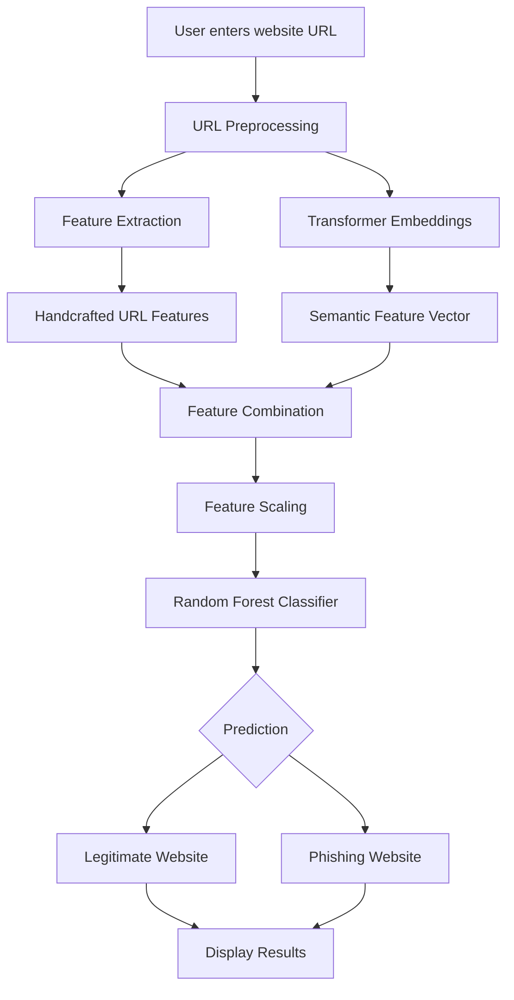

# 🛡️ PhishGuard — AI-Powered Phishing Website Detection

<p align="center">
  <strong>Browse Smart. Stay Safe.</strong>
</p>

<p align="center">
  An intelligent phishing website detection system that combines Machine Learning, Natural Language Processing, and URL-based feature engineering to identify potentially malicious websites.
</p>

---

## 📌 Overview

**PhishGuard** is an AI-powered web application designed to detect phishing websites and help users browse the internet more safely.

Phishing attacks are a common cybersecurity threat in which attackers create fraudulent websites that imitate legitimate platforms to steal sensitive information such as login credentials, banking details, and personal data.

PhishGuard analyzes submitted URLs using machine-learning techniques and automatically classifies them as:

- 🟢 **Legitimate** — The URL is classified as potentially safe.
- 🔴 **Phishing** — The URL is classified as potentially malicious.

The project uses a hybrid machine-learning approach that combines semantic URL representations with handcrafted URL-based features to improve classification.

> **Note:** A legitimate prediction does not guarantee that a website is completely safe. Always verify website addresses and avoid sharing sensitive information with untrusted websites.

---

## ✨ Key Features

- 🔍 **URL Scanning:** Analyze website URLs to identify potential phishing threats.
- 🤖 **Machine Learning Classification:** Uses a trained Random Forest-based classification model.
- 🧠 **Transformer-Based Embeddings:** Uses Sentence Transformers to generate semantic representations.
- ⚙️ **Feature Engineering:** Extracts URL characteristics such as domain information, URL length, special characters, and suspicious patterns.
- 📊 **Hybrid Detection:** Combines transformer embeddings and handcrafted URL features.
- 📈 **Model Evaluation:** Supports classification performance analysis.
- 🕘 **Scan History:** Provides access to previous scan results.
- 🎨 **Modern Web Interface:** Clean, responsive dark-themed interface with purple accents.
- ☁️ **Cloud Deployment:** Designed for deployment using Render.

---

## 🏗️ System Architecture

PhishGuard follows a hybrid machine-learning pipeline.



### Detection Workflow

1. The user enters a website URL into the PhishGuard interface.
2. The URL is preprocessed and normalized.
3. Handcrafted URL features are extracted.
4. Sentence Transformer generates an embedding representation.
5. Both feature sets are combined into a hybrid feature vector.
6. The feature vector is processed using the trained preprocessing pipeline.
7. The Random Forest model predicts the URL category.
8. The result is displayed on the web application.

---

## 🧠 Machine Learning Approach

### 1. Handcrafted URL Feature Extraction

The system analyzes different URL characteristics, including:

- URL length
- Domain length
- Path length
- Query length
- Number of dots
- Number of hyphens
- Number of special characters
- Number of digits
- Number of subdomains
- HTTPS presence
- IP address usage
- Port information
- Suspicious keywords
- Punycode presence
- URL shortening services

These features help identify patterns commonly associated with phishing URLs.

### 2. Transformer-Based Feature Extraction

The project uses:

**Sentence Transformer:** `sentence-transformers/all-MiniLM-L6-v2`

This model generates 384-dimensional semantic embeddings.

These embeddings provide additional representations that are combined with the handcrafted URL features.

### 3. Hybrid Feature Representation

The hybrid feature representation combines:

- 384-dimensional transformer embeddings
- 26 handcrafted URL features

**Total: 410 features**

The exact feature ordering and preprocessing must remain consistent between model training and prediction.

### 4. Classification Model

The primary classification model is:

**Random Forest Classifier**

Random Forest is an ensemble learning algorithm that combines multiple decision trees to generate predictions.

It is suitable for classification tasks involving multiple numerical features.

---

## 🗂️ Project Structure

```text
Phishing-Website-Detection/
│
├── app.py
│
├── src/
│   ├── feature_extraction.py
│   ├── embeddings.py
│   ├── preprocessing.py
│   ├── train.py
│   └── evaluation.py
│
├── models/
│   ├── hybrid_random_forest.pkl
│   ├── hybrid_model.pkl
│   ├── feature_scaler.pkl
│   ├── tfidf_model.pkl
│   ├── tfidf_vectorizer.pkl
│   └── transformer_model.pkl
│
├── data/
│   ├── raw/
│   └── processed/
│
├── reports/
│
├── requirements.txt
├── .gitignore
└── README.md
```

*Note: The structure above describes the main project components. Some training datasets and generated embeddings are excluded from GitHub because of their size.*

---

## 🛠️ Technologies Used

| Technology | Purpose |
|---|---|
| Python | Core programming language |
| Pandas | Data manipulation |
| NumPy | Numerical computation |
| Scikit-learn | Machine learning |
| Random Forest | URL classification |
| Sentence Transformers | Semantic embeddings |
| PyTorch | Transformer model support |
| Joblib | Model serialization |
| Streamlit | Web application |
| Git | Version control |
| GitHub | Source code hosting |
| Render | Cloud deployment |

---

## 📊 Dataset

The project uses the **PhiUSIIL Phishing URL Dataset** for model development and experimentation.

The dataset contains URL-related information used to train and evaluate phishing detection models.

### Dataset Processing

The general data-processing workflow includes:

1. Loading the dataset.
2. Cleaning and preprocessing URL records.
3. Preparing classification labels.
4. Extracting URL-based features.
5. Generating transformer embeddings.
6. Preparing training and testing datasets.
7. Training and evaluating the classification model.

**Important:** The raw dataset and large generated embedding files are not included in this GitHub repository to reduce repository size.

---

## ⚙️ Installation and Setup

Follow these instructions to run PhishGuard locally.

### Prerequisites

Install the following:

- Python
- Git
- Visual Studio Code
- pip package manager

### Step 1: Clone the Repository

```bash
git clone https://github.com/durgasaimax/Phishing-Website-Detection.git
```

### Step 2: Navigate to the Project

```bash
cd Phishing-Website-Detection
```

### Step 3: Create a Virtual Environment

```bash
python -m venv .venv
```

### Step 4: Activate the Virtual Environment

**Windows PowerShell:**

```powershell
.venv\Scripts\Activate.ps1
```

**Linux / macOS:**

```bash
source .venv/bin/activate
```

### Step 5: Install Dependencies

```bash
pip install -r requirements.txt
```

### Step 6: Run the Application

```bash
streamlit run app.py
```

The application will be available at:

```text
http://localhost:8501
```

---

## 🚀 Deployment

PhishGuard is designed for deployment using Render.

### Render Configuration

| Configuration | Value |
|---|---|
| Platform | Render |
| Service Type | Web Service |
| Runtime | Python |
| Branch | main |
| Build Command | `pip install -r requirements.txt` |
| Start Command | `streamlit run app.py --server.port $PORT --server.address 0.0.0.0` |

### Deployment Steps

1. Push the project to GitHub.
2. Sign in to Render.
3. Select **New Web Service**.
4. Connect your GitHub account.
5. Select the `Phishing-Website-Detection` repository.
6. Configure the build and start commands.
7. Deploy the application.
8. Open the generated Render URL.

**Deployment note:** The trained model and other required inference artifacts must be included in the repository or made available through another supported storage mechanism. Confirm that the deployed application can load its model files and transformer dependencies.

---

## 📈 Model Evaluation

The model should be evaluated using the following metrics:

| Metric | Description |
|---|---|
| Accuracy | Overall percentage of correct predictions |
| Precision | Proportion of predicted phishing URLs that are actually phishing |
| Recall | Proportion of actual phishing URLs correctly detected |
| F1-Score | Harmonic mean of precision and recall |
| ROC-AUC | Ability to distinguish between the two classes |
| Confusion Matrix | Breakdown of correct and incorrect predictions |

These metrics help evaluate the reliability of the phishing detection system.

Actual evaluation results should be added after reproducing the evaluation using the final saved model and test dataset.

---

## 🔐 Security Considerations

- Never enter sensitive personal information into suspicious websites.
- A URL classification result is not a guarantee of website safety.
- PhishGuard currently analyzes URL characteristics and learned representations; it should not be treated as a full website security scanner.
- Keep API keys and credentials outside the source code.
- Do not commit private credentials, environment files, or sensitive datasets.
- Model predictions may produce false positives and false negatives.

---

## 🔮 Future Improvements

Possible future enhancements include:

- Real-time phishing URL intelligence integration.
- Browser extension for automatic URL checking.
- Improved deep-learning-based classification.
- Website content and HTML analysis.
- Domain reputation and WHOIS analysis.
- Threat intelligence API integration.
- Advanced scan history and analytics.
- Improved model explainability.
- More extensive real-world testing.

---

## 🎯 Project Objectives

The primary objectives of PhishGuard are:

1. To develop an intelligent phishing website detection system.
2. To apply machine learning techniques to cybersecurity.
3. To combine semantic embeddings with handcrafted URL features.
4. To build an accessible web interface for URL analysis.
5. To demonstrate an end-to-end machine-learning application, from data processing to deployment.

---

## 👩‍💻 Author

**Durga Sai**

GitHub: [@durgasaimax](https://github.com/durgasaimax)

Project Repository: [Phishing-Website-Detection](https://github.com/durgasaimax/Phishing-Website-Detection)

---

## 📄 License

This project is intended for educational and research purposes.

Add an appropriate open-source license before permitting reuse or redistribution.

---

<p align="center">
  <strong>PhishGuard — Browse Smart. Stay Safe. 🛡️</strong>
</p>